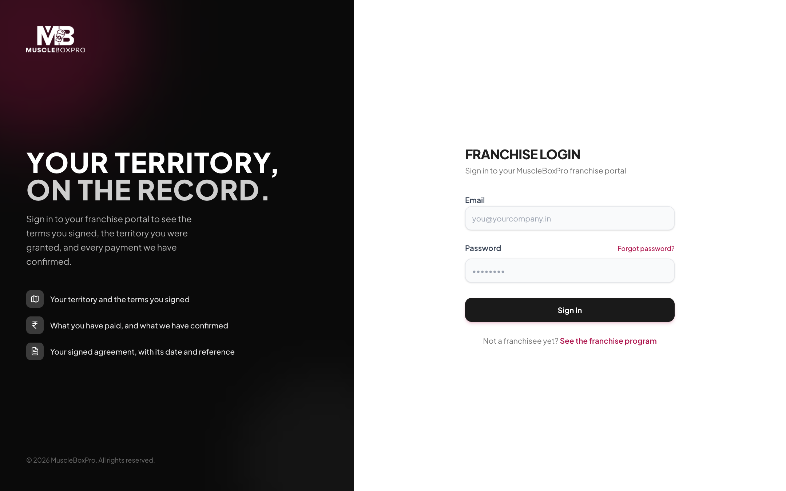

# 1. Getting started

## From enquiry to a live franchise

You become a franchise owner in four phases. Each one has a clear owner, so you always know whose
move it is.

| Phase | Step | What happens | Who acts |
| --- | --- | --- | --- |
| **Apply** | 1. Your details | Your business and contact details, as they will appear in the agreement | You |
| | 2. Your territory | The districts you want to develop, and the size of franchise you want | You |
| | 3. KYC and documents | Proof of your business, your address and the person signing | You |
| **Approval** | 4. Approval | MuscleBoxPro evaluates the market and confirms your territory | MBP |
| **Agree** | 5. Your franchise | What you put in, what you earn, and how you get your capital back | You read and acknowledge |
| | 6. Operations readiness | Your warehouse, operations contact and delivery arrangement | You |
| | 7. Review and sign | The agreement is signed electronically (Aadhaar OTP or a digital signature certificate) | You |
| **Fund** | 8. First instalment | You transfer the instalment and report the bank reference; MBP confirms it against the bank statement | Both |
| | 9. You're set up | Your signed agreement, your portal login and what happens next | |

A few things worth knowing before you start:

- **Your progress is saved as you go.** You can leave and come back to the same link.
- **Approval is a real decision.** MBP can approve, put an application on hold, or decline it, and
  the outcome shows on your page.
- **Signing is electronic and legally binding.** You sign with an Aadhaar OTP or a digital
  signature certificate. The signed agreement is kept on your record and you can quote its
  reference at any time.
- **Money is by bank transfer, checked by a person.** There is no card payment. You report the
  bank reference (UTR) and the amount; MBP confirms it against the bank statement. If the amount
  received differs from the amount you reported (for example because of bank charges), both
  figures are shown to you.

Once your first instalment is confirmed, MBP switches your franchise on and emails you. Until
then, your dashboard shows a clear *"You're not live yet"* message and the status of your
transfer.

## Signing in

Go to the franchise sign-in page and use the email and password you set when your account was
created.

- Use **Forgot password?** on the sign-in page to get a reset link by email.
- Sessions last a fixed time. When yours ends you are sent back to the sign-in page. You can also
  press **Sign out** at the bottom of the menu at any time.
- Every account is private to one franchise. You never see another franchise's machines or
  figures.

## Your account and your team

| Account | Who it is for | Can do |
| --- | --- | --- |
| **Franchise owner** (you) | The person who signed the agreement | Everything in this guide |
| **Operator** | People you hire to restock and test machines | Only the machines you assign, with no money or customer details. See [Your team](06-team.md) |

Gym owners also have their own, separate gym dashboard for the machine at their gym. They see
sales and status for that one machine and cannot change anything.

Next: [The dashboard](02-dashboard.md).
