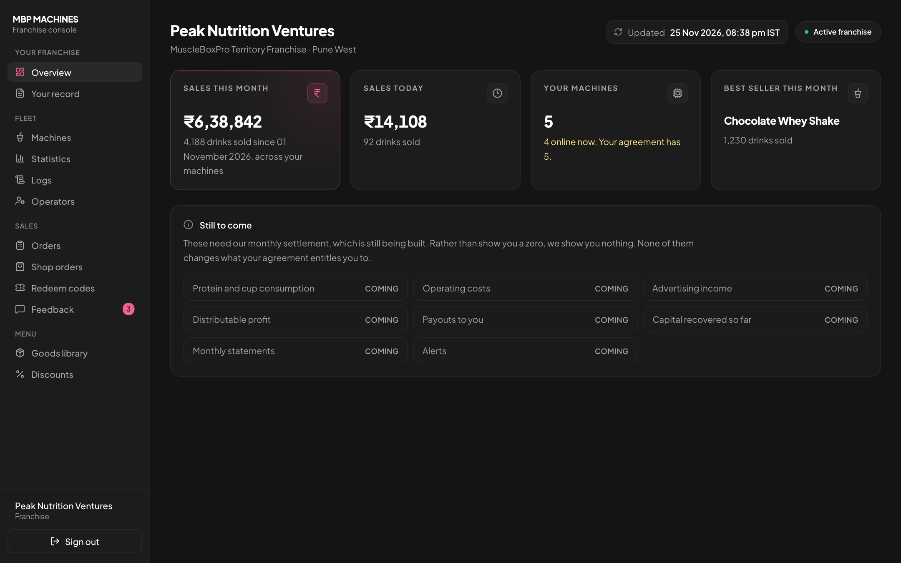
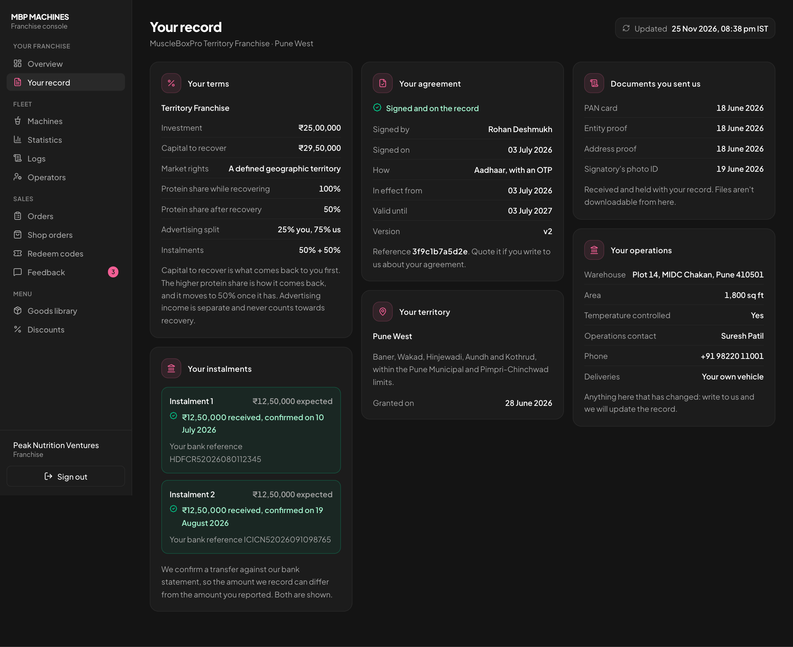

# 2. The dashboard

The dashboard has two pages under **Your franchise** in the menu: **Overview** and **Your record**.

## Overview

The first page you see after signing in. It answers: *how is my franchise doing today?*

Once your franchise is live, the top row shows:

| Card | What it tells you |
| --- | --- |
| **Sales this month** | Money taken across all your machines since the 1st, and the number of drinks sold |
| **Sales today** | Today's sales and drinks so far (times are IST) |
| **Your machines** | How many machines you have, how many are online right now, and how many your agreement provides. Select it to open the machine list |
| **Best seller this month** | The drink that sold the most, and how many |

The header shows your trade name, your franchise type and territory (for example *Territory
Franchise · Pune West*), when the page was last refreshed, and your **status**.

### Status

| Status | Meaning |
| --- | --- |
| Agreement signed | Signed. Waiting for the first instalment |
| Transfer reported | You have reported the transfer; MBP is checking it against the bank |
| First instalment confirmed | Confirmed. MBP will switch you on shortly |
| **Active franchise** | Live. Sales and machines appear on the Overview |

Until you are active, the Overview shows a notice that you are not live yet, your **investment
agreed**, the amount **confirmed by us** against our bank, and your instalments, so you can always
see where your money stands.

### What is not on the Overview yet

The bottom of the page lists the reports that are still being built (profit, payouts, statements and
so on). They are listed so you know they are coming, and are left out rather than shown as zero.
See [What is coming](07-coming-soon.md).

## Your record

Everything that stops changing once you have signed. It is your reference copy.

### Your terms

Your investment, what must be recovered, and how profit is shared, from your own record.

| Line | Meaning |
| --- | --- |
| Investment | What you put in, as signed |
| Capital to recover | The amount that comes back to you first |
| Market rights | The geography you were granted |
| Protein share while recovering / after recovery | Your share of protein profit during capital recovery, and the share that applies once your capital is recovered |
| Advertising split | Your share of advertising income, which is separate and never counts towards recovery |
| Instalments | How your investment was split into payments |

The higher protein share during recovery is the mechanism by which your capital comes back. It is
not a permanent margin.

### Your instalments

One row per instalment, showing the amount expected, the amount MBP confirmed, the date it was
confirmed, and your bank reference. If a transfer could not be confirmed, the page shows what was
found, so you know what to correct.

### Your agreement

Who signed, when, how (Aadhaar OTP, electronic or digital certificate), the dates it is in effect
and valid until, and its version. A short **reference** identifies the exact signed text. Quote it
if you write to MBP about your agreement.

### Your territory

The territory granted to you, its boundary in words, and the date it was granted.

### Documents you sent us

A list of the identity and business documents MBP holds for you, by type and date. The dashboard
confirms they arrived. It deliberately does not offer them for download.

### Your operations

The operations details you gave before signing: warehouse (or *not identified yet*), area,
temperature control, operations contact and phone, and how deliveries will be made. If anything has
changed, tell MBP and the record is updated.

Next: [Machines](03-machines.md).
