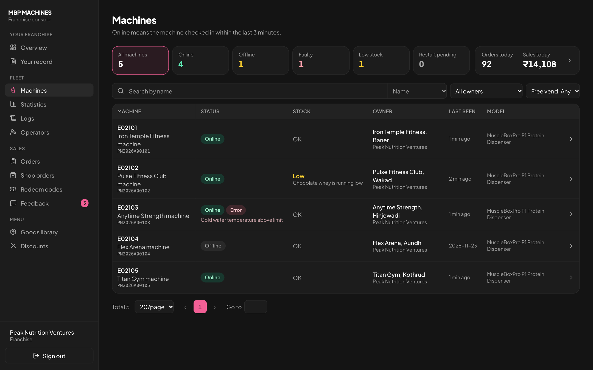
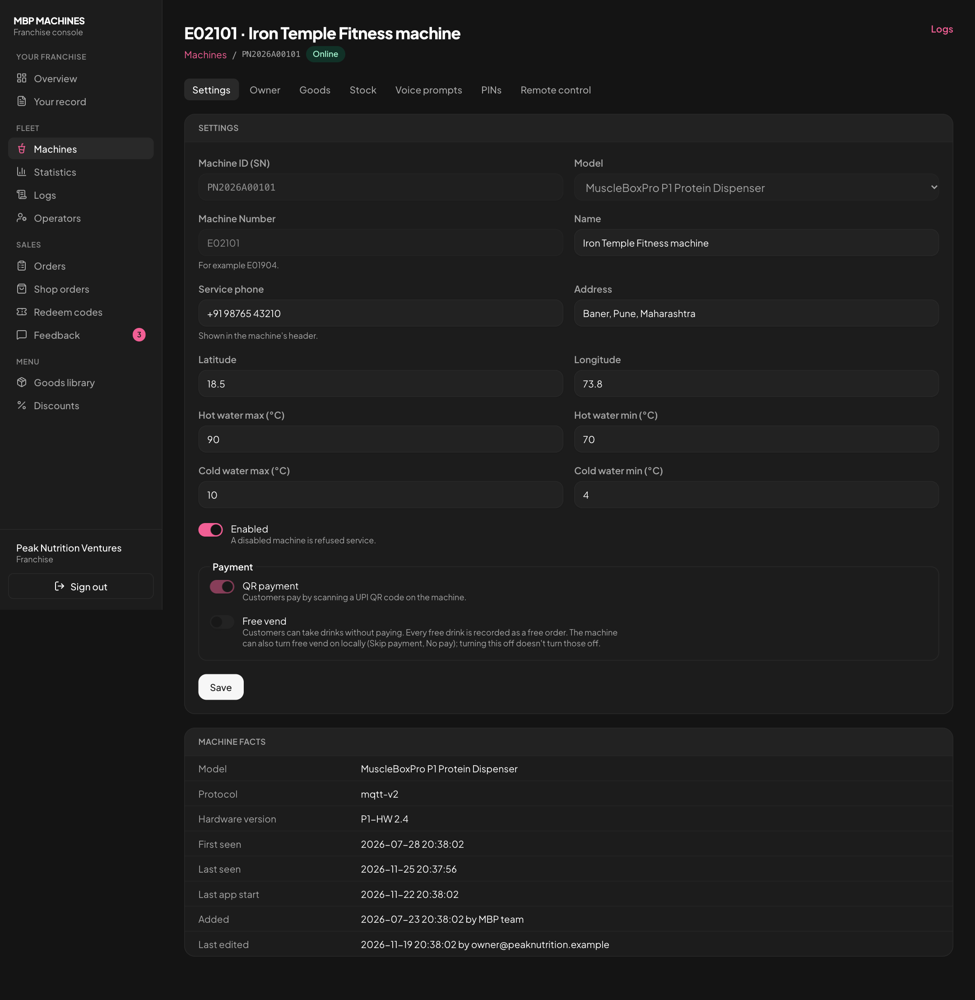
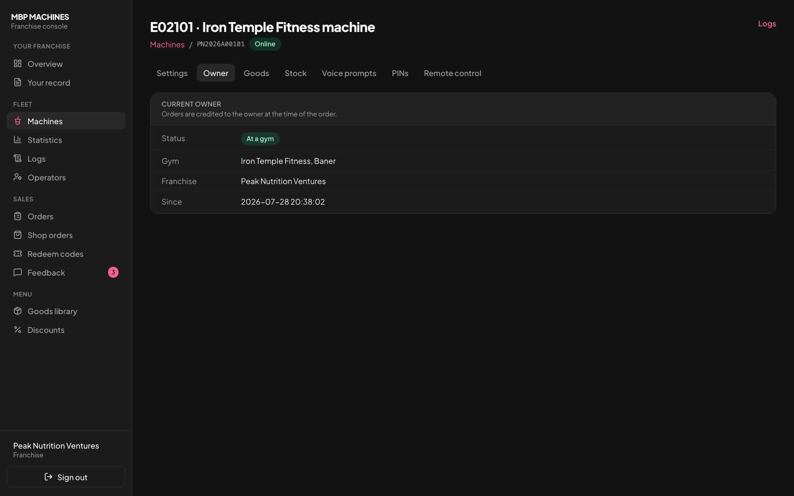
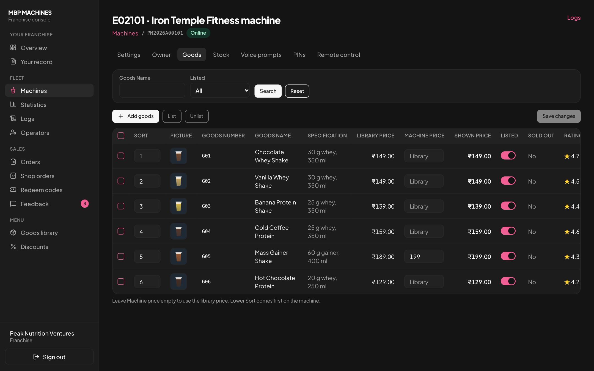
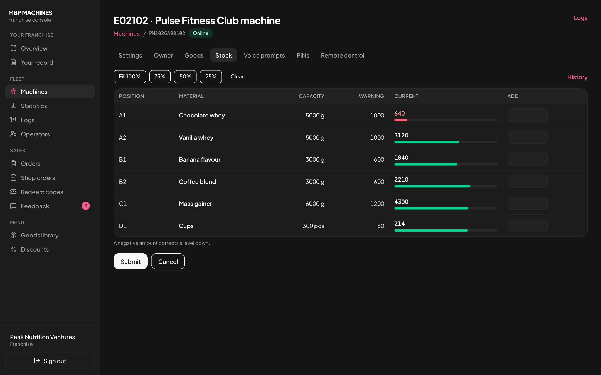
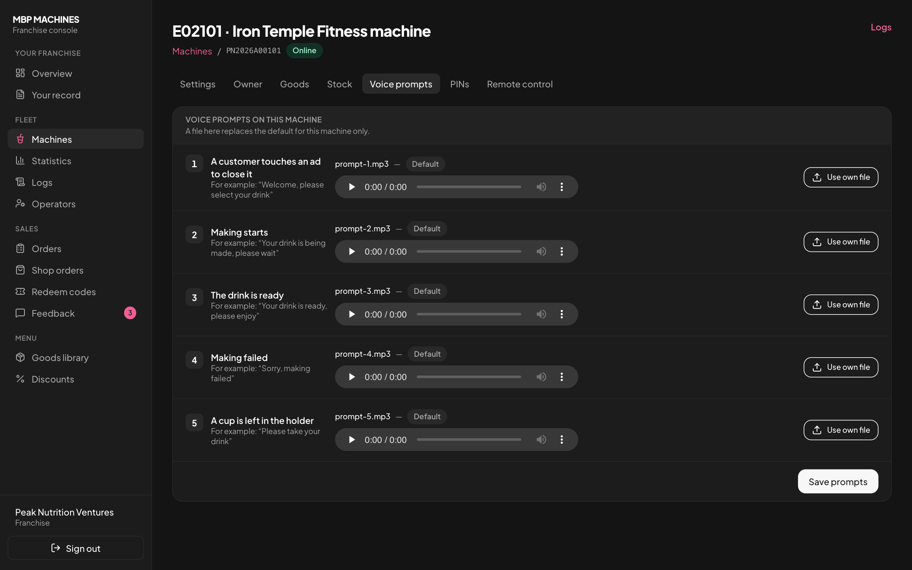
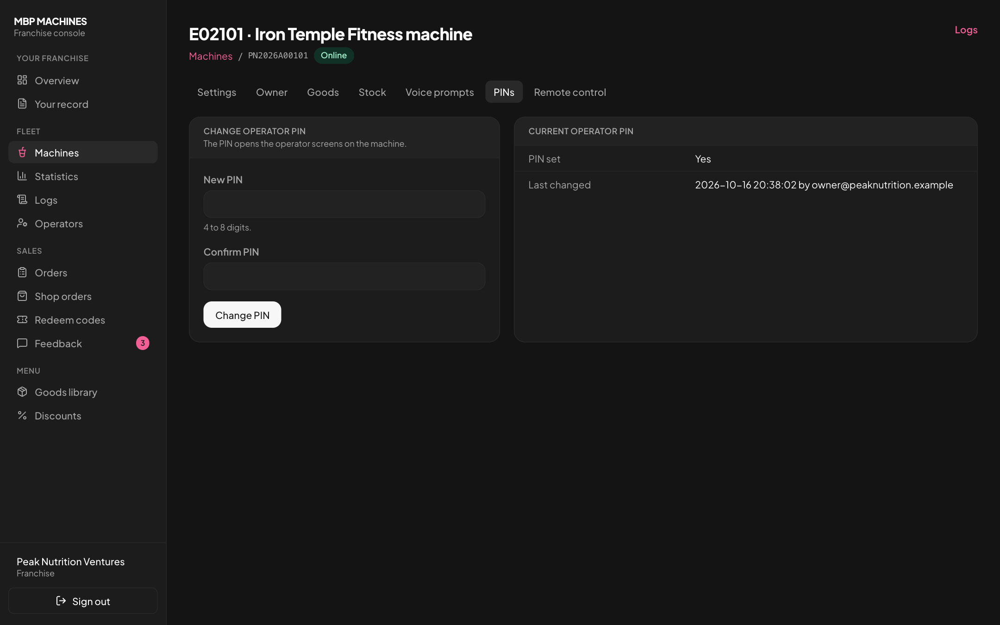
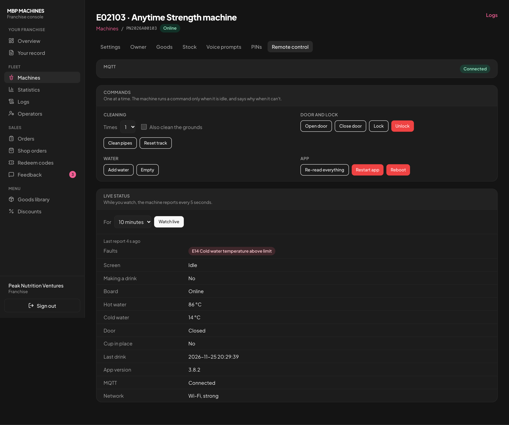
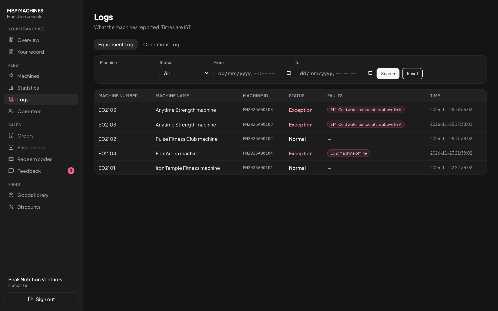

# 3. Machines: monitor and control

The **Machines** page is your fleet. Open any machine to configure it, restock it and control it
remotely. All of this is available on desktop and on a phone.

## Your fleet

**Fleet health tiles** along the top give you the whole picture in a glance:

| Tile | Meaning |
| --- | --- |
| All machines | Every machine you own, wherever it is |
| Online / Offline | A machine is *online* if it checked in within the last 3 minutes |
| Faulty | A machine has reported a fault |
| Low stock | A canister has fallen below its warning level |
| Restart pending | A setting change is waiting for the machine to restart |
| Orders today, Sales today | Today's drinks and money across the fleet |

**The list** shows each machine's number and name, status (Online, Offline or Error), stock
(OK or Low, with the reason), which gym it is at, when it was last seen, and its model. Search by
name, machine number or machine ID, and filter by owner (placed at a gym or held unplaced). Select
**Open** to manage a machine.

A machine's detail page has these tabs:

| Tab | What it is for |
| --- | --- |
| [Settings](#settings) | Name, location, service phone, water temperatures, on/off |
| [Owner](#owner) | Which gym it is at and since when |
| [Goods](#goods) | What the machine sells, its price and order on screen |
| [Stock](#stock) | Canister levels, restocking and restock history |
| [Voice prompts](#voice-prompts) | The machine's spoken prompts |
| [PINs](#pins) | The operator PIN |
| [Remote control](#remote-control) | Commands and live status |

## Settings

You can change:

- **Name**: how the machine appears in your lists.
- **Service phone**: shown in the machine's header, so customers know who to call.
- **Address, latitude and longitude**: where the machine is.
- **Hot water maximum and minimum** (40 to 98 °C) and **cold water maximum and minimum** (1 to
  25 °C).
- **Enabled**: switch a machine off. A disabled machine refuses service.

You can see, but not change:

- **Machine number** (for example E01904), model, hardware version and first and last seen.
- **QR payment**: customers pay by scanning a UPI QR code on the machine.
- **Free vend**: whether drinks are free. Free drinks are recorded as free orders.

Changes that need the machine to reload are flagged as *restart pending* until it has picked them
up.

## Owner

Shows which gym the machine is at, which franchise owns it, and since when. Orders are credited to
the owner at the time of the order. Moving a machine between gyms is done with MBP, so that
ownership and settlement stay correct.

## Goods

The drinks this machine sells, with picture, number, specification, library price, **machine
price**, the price shown to customers, whether it is listed, whether it is sold out, and its
customer rating.

You can:

- **List or unlist** a drink on this machine.
- **Add goods** from MBP's goods library.
- Set a **machine price** that overrides the library price on this machine only.
- Change the **sort** order on the machine's screen.

Prices and promotions are part of the shared MuscleBoxPro product and pricing framework. See
[Menu and pricing](05-menu-and-pricing.md).

## Stock

One row per canister: position, material, capacity, warning level and current level. A canister
below its warning level is marked **Low**, and the machine shows Low on your fleet list.

To restock:

1. Type the amount you added in the **Add** column. Or use **Fill 100%** (or 75%, 50%, 25%) to
   fill in, for every canister, the amount needed to bring it up to that share of its capacity.
   **Clear** empties the entries.
2. Select **Submit**. A negative amount corrects a level downwards.

**History** shows who restocked what and when, including changes the machine reported by itself.
Your operators can restock too, so you can see exactly who did it.

## Voice prompts

Each machine speaks five prompts: when an ad is closed, when making starts, when the drink is
ready, when making fails and when a cup is left in the holder. They start from MBP's defaults. Use
**Use own file** to replace any of them on this machine only, and **Save prompts**.

## PINs

The **operator PIN** opens the operator screens on the machine itself. You set it (4 to 8 digits)
and give it to your operators. The page shows whether a PIN is set, when it was last changed and by
whom. The separate factory PIN protects the machine's technical settings and stays with MBP.

## Remote control

Control a machine from anywhere. The tab shows whether the machine is **Connected**, then:

**Commands.** One at a time. The machine runs a command only when it is idle, and tells you why
when it can't (for example *it is making a drink*).

| Group | Commands |
| --- | --- |
| Cleaning | **Clean pipes** (1 to 5 cycles, optionally also the grounds), **Reset track** |
| Door and lock | **Open door**, **Close door**, **Lock**, **Unlock** (asks you to confirm) |
| Water | **Add water**, **Empty** |
| App | **Re-read everything** (reload settings and menu), **Restart app** (asks you to confirm), **Reboot** (asks you to confirm) |

Restart and reboot take the machine out of service for up to a couple of minutes, so you are asked
to confirm first.

**Live status.** Press **Watch live** for 1, 2, 5 or 10 minutes and the machine reports every five
seconds:

- Faults, with their codes and a plain description
- What the screen is doing, and whether a drink is being made
- Board online or offline
- Hot and cold water temperature
- Door open or closed, and whether a cup is in place
- The time of the last drink, the app version and the network

## Logs

The **Logs** page in the menu has two views, across all your machines:

- **Equipment log**: faults over time. Each entry has the machine, status (Normal or Exception),
  the fault codes and the time. Filter by machine, status and dates.
- **Operations log**: what happened on the machine, such as restocks and operator logins.

Use them to see when a fault started and who attended to a machine.

Next: [Sales and reports](04-sales-and-reports.md).
