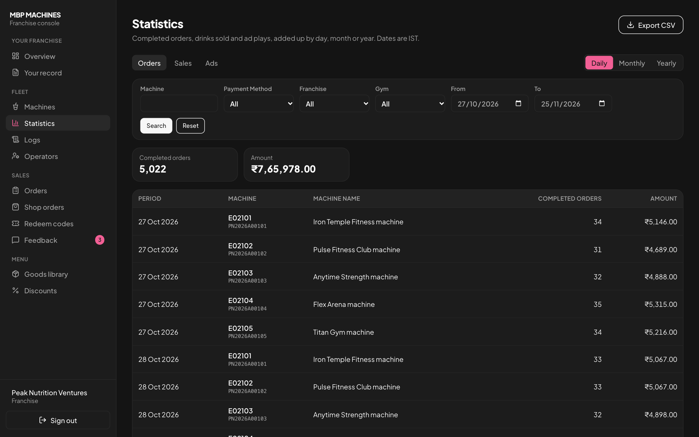
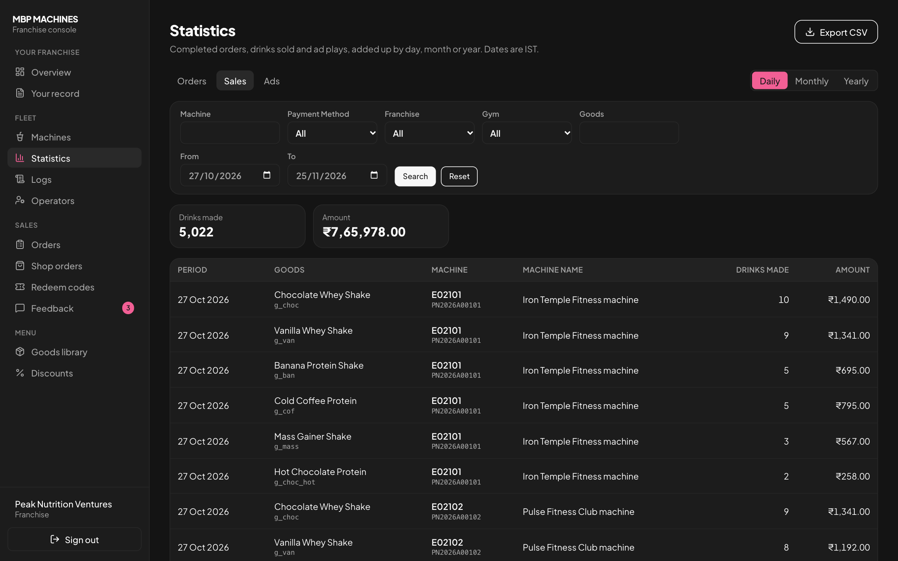
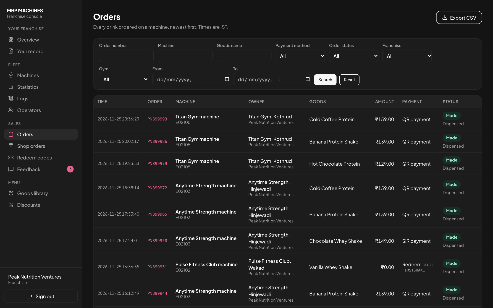
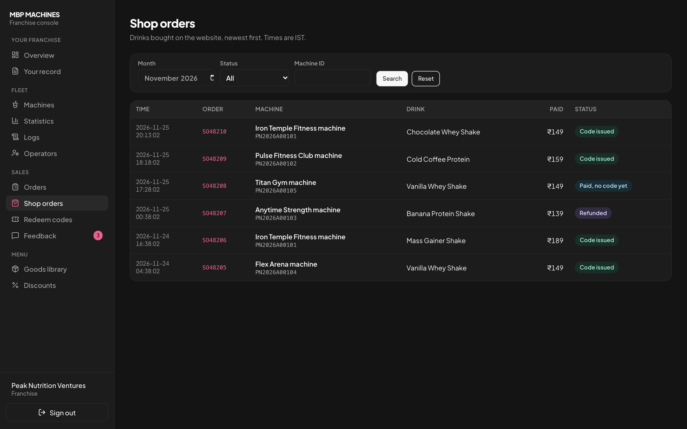
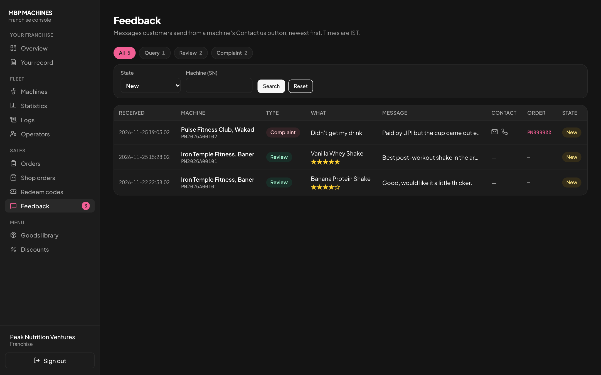
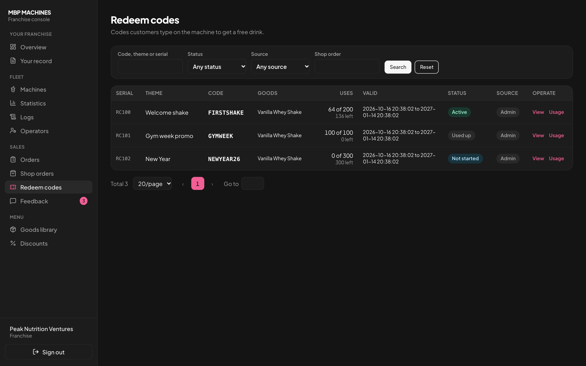

# 4. Sales and reports

The **Fleet** and **Sales** groups in the menu are where you track what your machines are selling.
Everything is limited to your own machines, and all times and dates are India Standard Time (IST).

## Statistics

Statistics add up your machines' results by **day, month or year**, with three views:

| View | What it counts |
| --- | --- |
| **Orders** | Completed orders and the money they brought in, per machine |
| **Sales** | Drinks made and the money for each drink, per machine |
| **Ads** | How many times each advertisement played and was touched |

Narrow the figures by **machine**, **payment method** (free, redeem code or QR payment), **gym**,
**drink** and **date range**. The total for your selection is shown above the table, and **Export
CSV** downloads exactly what you see, ready for your accountant or a spreadsheet.

Useful questions this answers:

- Which gym's machine sells the most, and which is falling behind?
- Which drink is your best seller, and where?
- How did this month compare with last month?
- How many drinks were given free or by redeem code?

## Orders

Every drink ordered on any of your machines, newest first.

| Column | Meaning |
| --- | --- |
| Time, Order | When it was ordered and its order number |
| Machine, Owner | Which machine and gym |
| Goods, Amount | The drink and the price paid |
| Payment | Free, Redeem code or QR payment |
| Status | *Created*, *Unknown*, *Made* or *Failed*, and whether the drink was dispensed |

Filter by order number, machine, goods, payment method, status, gym and dates. Open an order to
see its timeline (created, paid, made) and, for a failed order, the reason. **Export CSV**
downloads the list.

A failed order with a payment is the one to follow up quickly: it tells you which machine had the
problem and what went wrong, such as *cup not detected*.

## Shop orders

Customers can also buy a drink on the MuscleBoxPro website and collect it at a machine with a
code. This page lists those website orders for your machines.

| Status | Meaning |
| --- | --- |
| Awaiting payment | Started, not yet paid |
| Paid, no code yet | Paid, code on its way |
| Code issued | The customer has their pickup code |
| Refund queued, Refunding, Refunded, Refund failed | Where a refund has got to |
| Failed | The order did not complete |

Filter by month, status or machine. Customer contact details are not shown to you here, and
refunds and re-issuing codes are handled by MBP, because the money belongs to the customer and is
handled centrally.

## Feedback

Customers can write from a machine's **Contact us** button. Their messages come to you, newest
first.

- **Types:** Query, Review (with a star rating) and Complaint (with a reason such as *not
  dispensed*, *payment*, *taste* or *dirty*).
- **Contact:** the customer's email or phone, when they gave one, so you can reply yourself.
- **Order link:** a message about a particular drink shows its order number.
- **State:** mark each message **New**, **Replied** or **Closed**, and add a note for your team.

The menu shows a badge with the number of new messages, so nothing sits unread.

## Redeem codes

The free-drink codes that customers type on a machine. You see every code that works on your
machines: its theme, the drinks it covers, how many uses are allowed, used and left, the dates it
is valid, and its status (*Active*, *Not started*, *Used up*, *Expired*, *Disabled*). **Usage**
shows which orders used a code.

Codes are created and managed by MBP, so you can see how they perform without carrying the
responsibility of issuing them.

Next: [Menu and pricing](05-menu-and-pricing.md).
