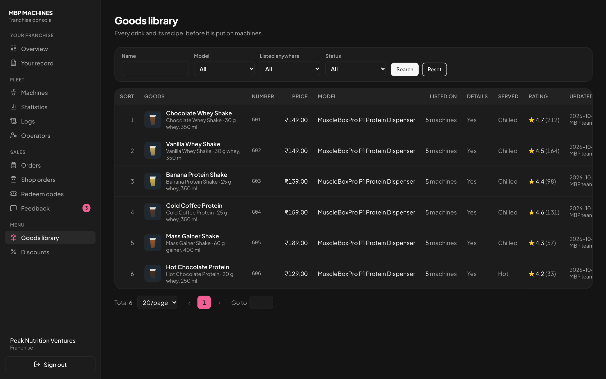
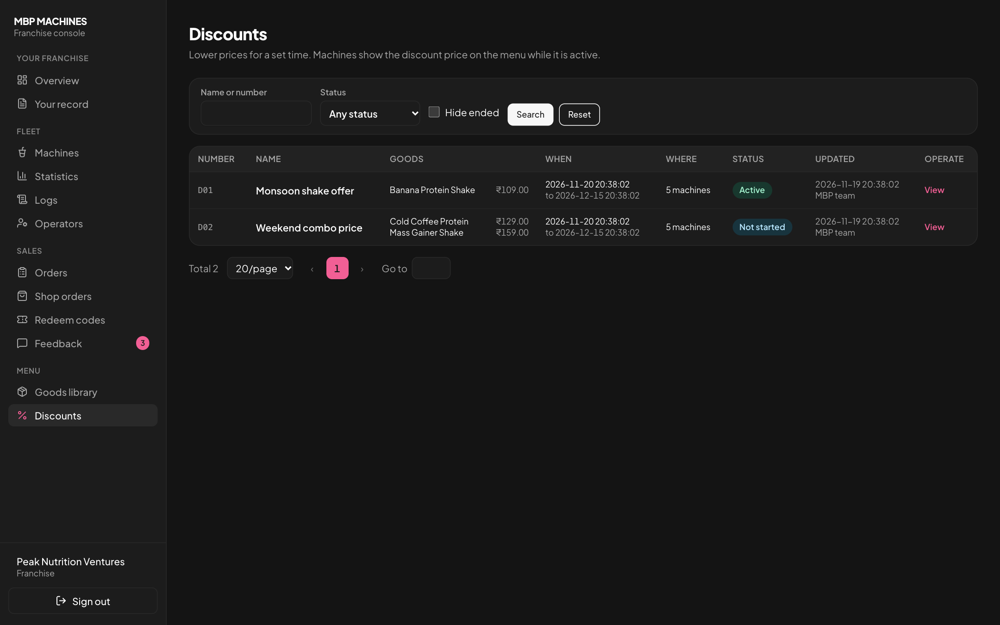

# 5. Menu and pricing

MuscleBoxPro keeps one shared menu of drinks and the standard pricing framework, so every machine
tastes and works the same way. You decide which of those drinks each of your machines offers.

## The goods library

Every drink MBP has approved, before it is put on any machine. For each one you can see:

- Name, number, specification and picture
- The **library price**
- Which machine model it is for
- How many machines it is **listed on**
- How it is served (chilled or hot)
- Customer rating and how many ratings it has
- When it was last updated

Open a drink to see its full details: tagline, nutrition, ingredients and the recipe. Recipes and
ingredients are held centrally, because a wrong recipe would produce a bad drink on every machine.
You can read them but not change them.

## Discounts

Time-limited lower prices that MBP runs on chosen machines. You can see each discount's name,
the drinks and the discounted price, when it runs, which machines it covers and its status
(*Not started*, *Active*, *Paused* or *Ended*). While a discount is active the machine shows the
discount price on its menu.

## What you control on your own machines

On each machine's **Goods** tab (see [Machines](03-machines.md#goods)) you can:

| Action | Effect |
| --- | --- |
| **List / Unlist** | Show or hide a drink on that machine |
| **Add goods** | Add another approved drink from the library to that machine |
| **Machine price** | Override the library price on that machine only |
| **Sort** | Choose the order of drinks on the machine's screen |

The pricing and product framework (formulations, approved ingredients, standard pricing and
promotions) is set by MBP and described in your agreement. Use machine prices within that framework.

Next: [Your team](06-team.md).
