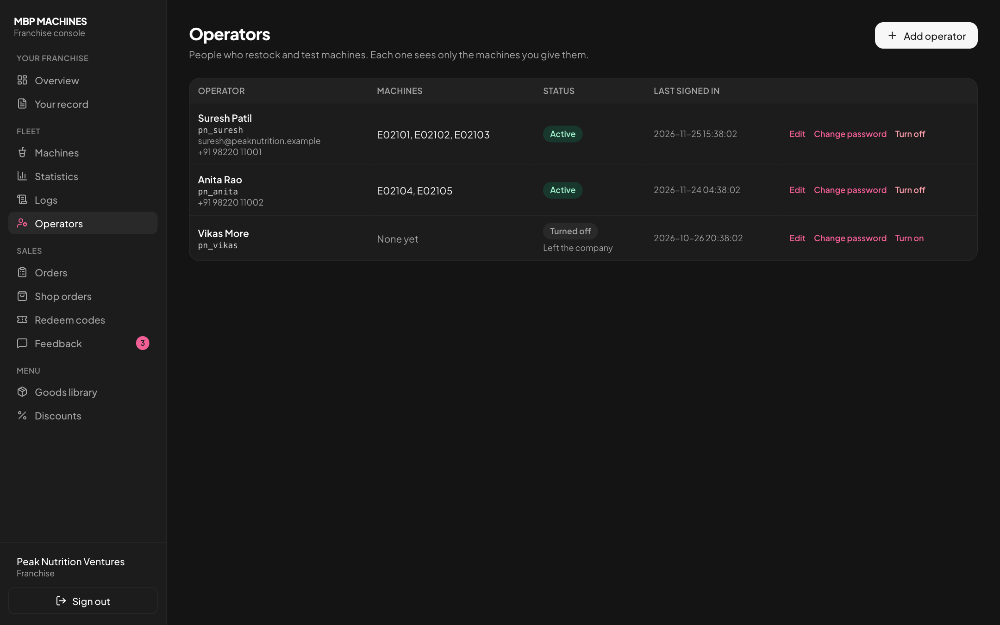

# 6. Your team: operators

The agreement makes you responsible for keeping machines stocked, clean and working. **Operators**
let the people who do that work have their own logins, without giving them access to your money or
your customers.

## What an operator is

An operator is a person you create, such as your warehouse or field staff. They sign in with an
**operator ID** (for example `pn_suresh`) and a password, on the console sign-in page. They see
only the machines you assign to them.

| An operator can | An operator cannot |
| --- | --- |
| See their machines, status and stock | See sales, orders or statistics |
| Restock canisters and see restock history | See customer details or feedback |
| Run cleaning, door, lock, water and restart commands | Change prices or the menu, apart from unlisting a drink that isn't working |
| Watch a machine's live status | Change the operator PIN or payment settings |
| Turn a broken machine off, and change a few machine settings (water temperatures, name, phone) | Create other operators |
| Read the equipment and operations logs | See other franchises or machines you did not assign |

## Managing operators

The **Operators** page lists each operator with their ID, name, contact details, assigned machine
numbers, status and when they last signed in.

| Action | What it does |
| --- | --- |
| **Add operator** | Create a login: a name, an operator ID (cannot be changed later), a password of at least 8 characters (there is a button to generate one), optional email and mobile, and the machines they look after. Nothing is emailed: you give them their ID and password yourself, and the password is shown only once |
| **Edit** | Change their name, contact details or assigned machines |
| **Change password** | Set a new password. They are signed out on every device and sign in again with it |
| **Turn off / Turn on** | Disable a login immediately, with an optional reason (for example *Left the company*), or re-enable it |

Turning an operator off takes effect straight away, and nothing is deleted: the history of what they
did stays in the logs.

## Accountability

Everything an operator does is recorded. The machine's **Stock** history and the **Operations log**
show who restocked, cleaned or signed in, and when, so you can see that your machines are being
looked after.

Next: [What is coming](07-coming-soon.md).
