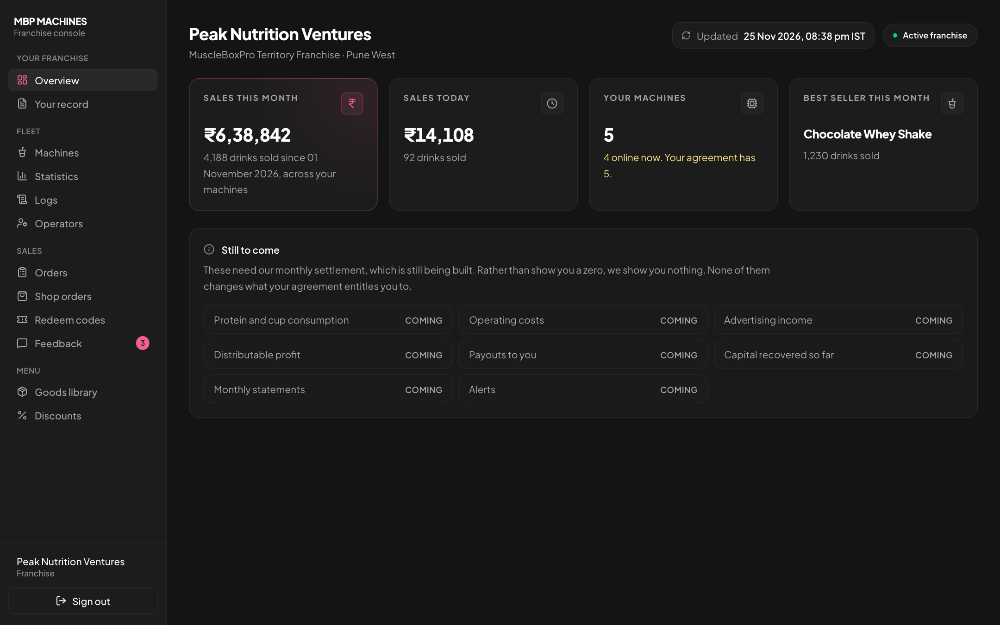
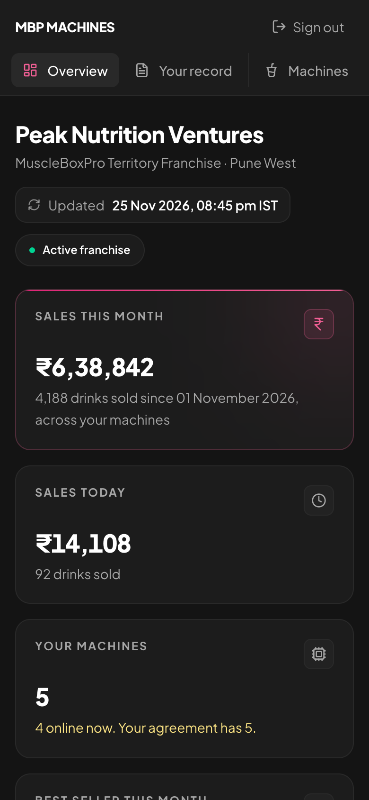

# MuscleBoxPro Franchise Owner Guide

Everything a franchise owner can see and do in the MuscleBoxPro franchise dashboard: from signing
the agreement, to running machines remotely, to tracking sales.

> **About the screenshots.** They show a sample franchise ("Peak Nutrition Ventures", Pune West) with
> invented gyms, drinks, customers and figures. Nothing in them is real business data. Your own
> dashboard shows your own machines, gyms and numbers.
>
> **About availability.** The Overview and Your record are live for every active franchise. The
> machine pages and operator logins are switched on per franchise as they roll out; see
> [What is coming](07-coming-soon.md#availability-on-your-account).

## What you get

| You want to | Where | Guide |
| --- | --- | --- |
| Sign in and understand your account | Franchise login | [Getting started](01-getting-started.md) |
| See how your franchise stands today | Overview | [Dashboard](02-dashboard.md) |
| Check your terms, territory, instalments and signed agreement | Your record | [Dashboard](02-dashboard.md) |
| See every machine, online or offline, and what needs attention | Machines | [Machines](03-machines.md) |
| Change a machine's name, temperatures, phone number or location | Machine, Settings | [Machines](03-machines.md) |
| Restock canisters and see the restock history | Machine, Stock | [Machines](03-machines.md) |
| Clean, lock, unlock, restart or re-read the menu on a machine from your phone | Machine, Remote control | [Machines](03-machines.md) |
| Watch a machine live: temperatures, door, faults | Machine, Remote control | [Machines](03-machines.md) |
| Choose which drinks a machine sells, and in what order | Machine, Goods | [Machines](03-machines.md), [Menu and pricing](05-menu-and-pricing.md) |
| Set the operator PIN for a machine | Machine, PINs | [Machines](03-machines.md) |
| See sales by day, month or year, by drink and by machine | Statistics | [Sales and reports](04-sales-and-reports.md) |
| See every drink ordered, with payment and dispensing status | Orders | [Sales and reports](04-sales-and-reports.md) |
| See drinks bought on the website for your machines | Shop orders | [Sales and reports](04-sales-and-reports.md) |
| Read and answer customer feedback | Feedback | [Sales and reports](04-sales-and-reports.md) |
| See free-drink codes that work on your machines | Redeem codes | [Sales and reports](04-sales-and-reports.md) |
| See the drinks library and running discounts | Goods library, Discounts | [Menu and pricing](05-menu-and-pricing.md) |
| Give your restocking team their own logins | Operators | [Your team](06-team.md) |
| Review faults and what happened on a machine | Logs | [Machines](03-machines.md#logs) |
| Know what is coming next (profit, payouts, statements) | Overview | [What is coming](07-coming-soon.md) |
| Know exactly what you can and cannot change | | [What you can change](08-what-you-can-change.md) |

## How the dashboard is organised

You sign in once and get a single console with a menu on the left.

| Menu group | Pages |
| --- | --- |
| **Your franchise** | Overview, Your record |
| **Fleet** | Machines, Statistics, Logs, Operators |
| **Sales** | Orders, Shop orders, Redeem codes, Feedback |
| **Menu** | Goods library, Discounts |

You only ever see your own machines: the ones at your gyms and any you hold that are not yet placed.
Other franchises, and MBP's own machines, are never visible to you.

The console works on a phone as well as a desktop.

## Who does what

| | MuscleBoxPro | You (the franchise) |
| --- | --- | --- |
| Machines, software, payment collection | Provides and owns them | Operate them in your territory |
| Protein and approved products | Supplies to your warehouse | Store, move and stock them |
| Menu, recipes and pricing framework | Sets and maintains | Choose what each of your machines lists |
| Technical support and OEM warranty | Provides | Report issues promptly |
| Gym relationships | Final approval of locations | Find, approach and look after gyms |
| Day-to-day stocking and upkeep | | Yours, with your own operators |

The binding detail is always in your signed agreement. This guide describes the dashboard; it does
not replace the agreement.

## Questions

Write to the MuscleBoxPro franchise team and quote the reference shown on your **Your record** page.
